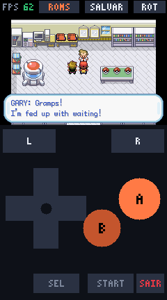
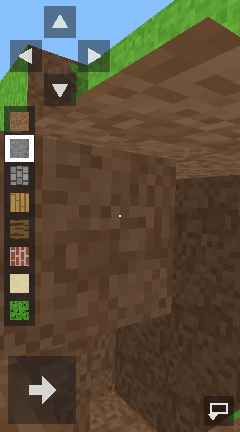
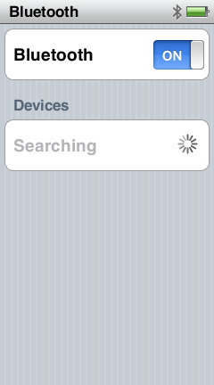
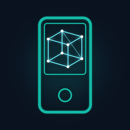

<p align="center">
  
</p>

<h1 align="center">NanoEmu</h1>

<p align="center">
  A QEMU-based emulator for the <b>iPod nano 7th generation</b> (2012)<br>
  Hardware preservation, homebrew research, and a testbed for a future custom OS.
</p>

<p align="center">
  
  
  
  
</p>

---

## What it does today

Boots the **real RetailOS** from a live device snapshot into a **clickable window** (VNC), with working buttons, touch, persistent flash storage, and correct power behavior. The OS renders its own UI, opens apps when you tap them, dims and locks the screen when idle, and wakes when you press Home.

<table align="center">
  <tr>
    <td align="center"><br><i>Real RetailOS home screen</i></td>
    <td align="center"><br><i>Music opened by a mouse tap</i></td>
  </tr>
  <tr>
    <td align="center"><br><i>GBA homebrew at 62 FPS</i></td>
    <td align="center"><br><i>MBX GPU rendering real 3D</i></td>
  </tr>
</table>

<p align="center">
  
</p>

<p align="center"><i>Settings &gt; Bluetooth: ON and searching for devices.</i></p>

## NanoGL — the GPU renderer

<p align="center">
  
</p>

NanoGL is our reimplementation of the iPod nano 7G's PowerVR MBX Lite (GLES 1.1 fixed function), built from scratch and validated against a 65-variant GL test suite plus real 3D homebrew:

| Supported | In progress |
|---|---|
| Geometry (IoU 1.000 vs analytic reference) | PVRTC / paletted textures ([spec ready](docs/research/gpu-deep-dive.md)) |
| Full VGP interpreter (custom microcode path) | MK64 as the final stress test |
| Textures (wrap + clamp), depth, alpha blending/test | |
| Back-face culling, bilinear, mipmaps | |
| Near-plane + user clip planes, glColorMask | |
| Fixed-function lighting, normals, points, lines, sprites | |
| Fog (LINEAR/EXP/EXP2), texture env combine, GL_BLEND | |

Runs: gltest (77 variants) + Blocks (full 3D game) + your homebrew. [Full matrix and evidence](docs/NanoGL.md)

## The hardware inside

| | |
|---|---|
| 🧠 **SoC** | Samsung S5L8747-class ("N31"), ARM Cortex-A5 single core |
| 💾 **Memory** | 64 MB DRAM + 256 KB SRAM (unified, no separate VRAM) |
| 🖥️ **Display** | 240x432 @ 60 Hz, 32-bit color |
| 🎮 **GPU** | PowerVR MBX Lite (2D + 3D, OpenGL ES 1.1) |
| 🎬 **Video** | Apple M2 H.264 hardware decoder |
| 🔊 **Audio** | I2S + SPI codec + DMA engine |
| 📡 **Wireless** | Bluetooth classic BR/EDR + BLE (HCI, L2CAP, A2DP) |
| 💽 **Storage** | 16 GB NAND flash, PPN controller, 16 KB pages |
| 🔌 **Ports** | USB 2.0 OTG (DWC2), Lightning connector |
| 🔒 **Crypto** | AES + SHA-1 + RSA hardware engines |

Full register-level details: [`docs/HARDWARE.md`](docs/HARDWARE.md)

## Key discoveries so far

- ⚡ **The CPU is capped:** PLL1 runs at 684 MHz but the divider holds the core at 342 MHz. A single CLKCON register write doubles it ([`docs/research/oc.md`](docs/research/oc.md), [`docs/research/overclock-codex.md`](docs/research/overclock-codex.md))
- 🎮 **The GPU is capped too:** the PowerVR MBX Lite runs at 133 MHz stock (PLL2/2) and is unlockable to 171 MHz (driver-safe) or 266 MHz max, again a single divider write ([`docs/research/gpu-clock.md`](docs/research/gpu-clock.md))
- 🧠 **No 8 MB app heap quota:** homebrew apps share a 40 MB OS heap; memory pressure comes from fragmentation, not a hard cap ([`docs/research/ram-map.md`](docs/research/ram-map.md))
- 📻 **FM radio lives inside the Bluetooth chip** (Broadcom, HCI vendor command 0xFC15) ([`docs/research/radio.md`](docs/research/radio.md))
- 📡 **Full classic Bluetooth stack present** (HCI/L2CAP/RFCOMM/A2DP/SSP), enabling fast host channels and HID gamepads ([`docs/research/bluetooth-stack.md`](docs/research/bluetooth-stack.md))
- 🎬 **Hardware H.264 decoder** (Apple M2) mapped, making video playback and low-res streaming viable ([`docs/research/h264-decoder.md`](docs/research/h264-decoder.md))
- 🏃 **Accelerometer API mapped** (I2C slave 0x18, 100 Hz, 8-slot subscriber callbacks) ([`docs/research/accel.md`](docs/research/accel.md))
- 💾 NAND streaming measured at ~25-35 MB/s reads, viable for open-world-style asset streaming ([`docs/research/swap.md`](docs/research/swap.md))
- 📶 **No Wi-Fi exists (corrected finding):** the wireless chip is a Broadcom BCM2078 (Bluetooth 4.0 + FM receiver only, no Wi-Fi silicon), and the SoC has no SDIO host at all ([`docs/research/wifi-verdict.md`](docs/research/wifi-verdict.md))
- ❄️ **Cold boot without any device is viable:** the running system's decrypted code can be repackaged into plaintext boot images, and the emulated bootrom/UEFI validators can be patched to skip RSA, no iPod required again ([`docs/research/coldboot-zero-device.md`](docs/research/coldboot-zero-device.md))
- 🚀 **2.5-3x more CPU on the table:** L1 prefetcher off by Apple, VFPv4-D16 usable, IRAM for hot loops, plus the 684 MHz unlock ([`docs/research/cpu-deep-dive.md`](docs/research/cpu-deep-dive.md))
- 🎮 **GPU has unused silicon:** PVRTC + paletted texture support (4x less texture bandwidth), 266 MHz timing poke ([`docs/research/gpu-deep-dive.md`](docs/research/gpu-deep-dive.md))
- 🔀 **Dualboot without touching NAND:** warm kexec chainloader plan validated, zero brick risk, stock OS stays bootable; the diagnostic slot is confirmed dead without an RSA exploit ([plan](docs/research/dualboot-chainloader-plan.md), [diag audit](docs/research/diag-slot-deep-dive.md))
- 🖥️ **Display limits are physical:** 240x432 and 60 Hz are hard-wired in the panel's COG driver, not software caps ([verdict](docs/research/display-cap.md))
- 🔒 The GID AES key is unreadable by software (confirmed), so official IPSW payloads still need a one-time on-device oracle pass if we ever want to boot them byte-identical ([`docs/research/efuse.md`](docs/research/efuse.md))

## Feature status

| Subsystem | Status |
|---|---|
| CPU / RAM / IRAM | ✅ Complete (Cortex-A5, 64 MB) |
| Interrupts (dual VIC) + timers | ✅ Complete |
| NAND flash (FMC + FMSS sequencer) | ✅ With sparse backing store; FTL accepts read-after-write |
| Display (blitter + LCD, 60 Hz) | ✅ OS-rendered frames (60 Hz and 240x432 confirmed as hard panel limits, [verdict](docs/research/display-cap.md)) |
| Live window (VNC) + touch + keys | ✅ Working |
| PMU (battery, charger, RTC) | ✅ Working |
| Audio (ADSP + I2S + codec) | ✅ **Working: real MP3 decode (minimp3), live playback via `--audio-play`** |
| Real disk content | ✅ Cloned disk image boots; homebrew apps and real music library work |
| Save states + controls | ✅ Save/load, reset, rotate, pause, fast-forward, zoom, screenshots |
| Usage HUD | ✅ Live CPU/GPU/RAM graphs (reads the real OS heap), F10 toggle |
| Clock profiles + thermals | ✅ STOCK / SAFE / MAX profiles, thermal governor, F11 cycling |
| GPU (PowerVR MBX Lite) | ✅ **NanoGL renderer**: full VGP interpreter, textures, depth, blending, culling, alpha test, filtering, mipmaps, clipping, lighting, fog, lines, points, sprites ([full feature matrix](docs/NanoGL.md)) |
| Video decoders (M2) | 🟡 MPEG-4/H.263 block modeled; real H.264 block identified (0x38f00000/IRQ35) |
| Bluetooth (classic + BLE) | ✅ HID gamepad host working: pairing with security (L2CAP + bonding), HID descriptor over SDP, live reports drive an on-screen app ([research](docs/research/bluetooth-stack.md)) |
| Cold boot (zero device) | 🟡 Route confirmed: rebuild Type 4 plaintext images from dumps we already have + bypass signature checks in the emulated boot chain ([`docs/research/coldboot-zero-device.md`](docs/research/coldboot-zero-device.md), milestone plan in [`coldboot-plan.md`](docs/research/coldboot-plan.md)) |
| macOS build | ⬜ Planned (user's MacBook M2; interactive window + touch there) |
| Windows build | ⬜ Planned (native window; the browser/noVNC route proved unreliable for keyboard+touch input) |

Full hardware specs live in [`docs/HARDWARE.md`](docs/HARDWARE.md); reverse-engineering notes live in [`docs/research/`](docs/research/). The session-by-session development journal is [`emulator/boot-progress.md`](emulator/boot-progress.md).

## Building

```sh
cd emulator
./build.sh   # downloads QEMU 9.1.2, installs the nano7 machine, builds qemu-system-arm
```

## Running

Resuming a captured device snapshot (see [`probe/`](probe/) for how to capture one from your own device):

```sh
./run.sh --ramfull <snap>/ram-full.bin --iram <snap>/iram.bin \
         --ctx fixups/<snap>-ctx.bin --overlay <snap>/overlay.bin \
         --os-poke-file <fixups>.poke --torn-map <snap>/torn-map.bin \
         --nand-miss oracle --vnc 5
```

Then point any VNC viewer at `HOST:5905`. Mouse clicks are touch input; `h`, `p` and `space` are the Home, Power and Play/Pause buttons.

## On-device probes

[`probe/`](probe/) contains homebrew apps (NanoApps SDK) used to capture the state of a real device: DumpROM (bootrom) and DumpRAM v6 (near-atomic 64 MB RAM + registers capture with tear detection and an interrupt-masked overlay). See [`probe/INSTALL.md`](probe/INSTALL.md).

**No Apple firmware is included in this repository.** You capture dumps from your own device with the probe apps.

## Roadmap

1. ~~Homebrew app support from real disk content~~ ✅
2. ~~Audio output~~ ✅ (MP3 decode + live playback)
3. ~~GPU rendering~~ ✅ (NanoGL complete); H.264 video decoder in progress (spec: [`docs/research/h264-real-block.md`](docs/research/h264-real-block.md))
4. ~~Classic Bluetooth channel + HID gamepad~~ ✅ done in emulator (paired, encrypted, descriptor-driven)
5. Cold boot from reconstructed plaintext images (zero-device route confirmed)
6. Dualboot chainloader (pieces 1-2 of 4 built; [plan](docs/research/dualboot-chainloader-plan.md))
7. macOS and Windows native builds

See [CHANGELOG.md](CHANGELOG.md) for the release history.

## Related work

NanoEmu is, to our knowledge, the first emulator for the iPod nano 7G (S5L8747-class SoC). These projects inspired us and prove the community keeps iPods alive:

- [devos50: iPod Touch 1G in QEMU](https://devos50.github.io/blog/2022/ipod-touch-qemu/) - the pioneer, iPhoneOS 1.0 rehosting
- [lemonjesus/qemu-ipod-nano](https://github.com/lemonjesus/qemu-ipod-nano) - iPod nano 3G in QEMU, boots RetailOS with USB enumeration
- [iPod Classic 6G in QEMU](https://news.ycombinator.com/item?id=49611240) - S5L8702, boots retailOS with working navigation
- [wInd3x](https://github.com/freemyipod/wInd3x) and [S5Late](https://github.com/m-gsch/s5late) - nano 7G code execution research
- [freemyipod](https://github.com/freemyipod) - the classic iPod reverse-engineering community

## Credits

- The jailbreak and homebrew ecosystem this builds on: **wInd3x** and the **NanoApps** SDK community
- QEMU © its contributors (GPLv2)
- All device firmware remains the property of Apple and is not distributed here

## Disclaimer

Independent research and interoperability work on hardware owned by the authors. Not affiliated with Apple Inc. "iPod" is a trademark of Apple Inc.
