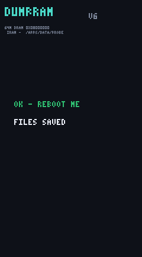

# NanoEmu

A work-in-progress QEMU-based emulator for the **iPod nano 7th generation** (2012, Samsung S5L8747-class SoC, Cortex-A5, 64 MB DRAM) — built for hardware preservation, homebrew development, and eventually running custom software on (and alongside) the original RetailOS.

The goal: boot the original nano 7G firmware in a window on your computer, with the mouse as the touchscreen and keyboard keys as the physical buttons — and use it as a safe testbed for a future custom OS.



*Above: the real RetailOS running in NanoEmu rendered this screen by itself (240×432). It resumed from a live RAM snapshot of a real device, ran its own UI loop, drew frames, and eventually auto-dimmed the display — just like a real iPod left idle.*

## Current status

- ✅ Custom QEMU 9.1.2 machine (`nano7`): CPU, RAM, IRAM
- ✅ Real SecureROM bootrom dump executes (verified authentic)
- ✅ Interrupt controller (dual PL192-style VIC), timers (500 Hz scheduler tick, 1 MHz clock)
- ✅ NAND flash controller (FMC) including the FMSS command sequencer, with a real sparse backing store — read-after-write accepted by the device's FTL/filesystem
- ✅ SPI command engine (PMU/backlight), GPIO, I2C, power-gating — enough for the OS to run unmodified
- ✅ Stable resume from a live-device RAM snapshot: 90k+ syscalls and 45k+ interrupts per 90 s run, no panics
- ✅ Display pipeline: frame-done IRQ, framebuffer capture — the OS renders its own screens
- ✅ Correct idle/auto-lock behavior (screen dims and powers off like real hardware)
- 🔜 Wake/input path (buttons + touch), live QEMU display window
- ⬜ Boot-to-Home-screen with real disk content
- ⬜ macOS build

## Repository layout

- `emulator/` — the QEMU machine (`machine/hw/arm/nano7*.c`), `build.sh` (self-contained: downloads QEMU 9.1.2, installs the machine, builds), `run.sh` (boot/resume wrapper), `fixups/` (snapshot analysis/repair tools), `boot-progress.md` (full development journal, session by session)
- `probe/` — on-device homebrew apps used to capture the machine state (DumpROM: bootrom capture; DumpRAM v6: near-atomic 64 MB RAM + IRAM + register-context capture with tear detection), plus packaging tools
- `docs/research/` — reverse-engineering notes: NAND/FMC protocol, PPN flash detection, LCD controller, touch input, bootrom analysis
- `docs/images/` — screenshots

**No Apple firmware is included or needed in this repo.** You supply your own dumps from your own device (the probe apps in `probe/` do exactly that).

## Building

```sh
cd emulator
./build.sh    # downloads QEMU 9.1.2, installs the nano7 machine, builds qemu-system-arm
```

## Running

Resuming a captured device snapshot (see `probe/` for how to capture one):

```sh
./run.sh --ramfull <snap>/ram-full.bin --iram <snap>/iram.bin \
         --ctx fixups/<snap>-ctx.bin --overlay <snap>/overlay.bin \
         --os-poke-file <fixups>.poke --torn-map <snap>/torn-map.bin \
         --nand-miss oracle --disp-dump screens/out \
         -M nano7,mmu=<L1-table-addr>
```

See `emulator/boot-progress.md` for the canonical commands and what each flag does.

## On-device probes

`probe/` contains the NanoApps-SDK homebrew apps used to dump the bootrom and capture consistent full-RAM snapshots of a running device (including an interrupts-masked atomic capture of volatile kernel regions). See `probe/INSTALL.md`.

## Credits

- The jailbreak/app ecosystem this builds on: **wInd3x** and the **NanoApps** SDK community
- QEMU © its contributors
- All device firmware/dumps remain the property of Apple and are not distributed here

## Disclaimer

Research and interoperability work on hardware owned by the authors. Not affiliated with Apple. "iPod" is a trademark of Apple Inc.
