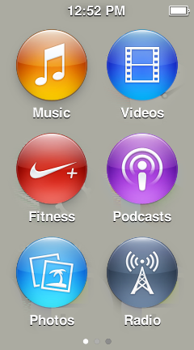
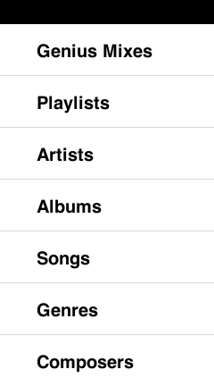

<p align="center">
  
</p>

<h1 align="center">NanoEmu</h1>

<p align="center">
  A QEMU-based emulator for the <b>iPod nano 7th generation</b> (2012)<br>
  Hardware preservation, homebrew research, and a testbed for a future custom OS.
</p>

<p align="center">
  
  
  
  
</p>

---

## What it does today

Boots the **real RetailOS** from a live device snapshot into a **clickable window** (VNC), with working buttons, touch, persistent flash storage, and correct power behavior. The OS renders its own UI, opens apps when you tap them, dims and locks the screen when idle, and wakes when you press Home.

<p align="center">
  
</p>

<p align="center"><i>The Music app, opened by a mouse tap in the live window.</i></p>

## The hardware inside

| | |
|---|---|
| 🧠 **SoC** | Samsung S5L8747-class ("N31"), ARM Cortex-A5 single core |
| 💾 **Memory** | 64 MB DRAM + 256 KB SRAM (unified, no separate VRAM) |
| 🖥️ **Display** | 240x432 @ 60 Hz, 32-bit color |
| 🎮 **GPU** | PowerVR MBX Lite (2D + 3D, OpenGL ES 1.1) |
| 🎬 **Video** | Apple M2 H.264 hardware decoder |
| 🔊 **Audio** | I2S + SPI codec + DMA engine |
| 📡 **Wireless** | Bluetooth classic BR/EDR + BLE (HCI, L2CAP, A2DP) |
| 💽 **Storage** | 16 GB NAND flash, PPN controller, 16 KB pages |
| 🔌 **Ports** | USB 2.0 OTG (DWC2), 30-pin dock |
| 🔒 **Crypto** | AES + SHA-1 + RSA hardware engines |

Full register-level details: [`docs/HARDWARE.md`](docs/HARDWARE.md)

## Feature status

| Subsystem | Status |
|---|---|
| CPU / RAM / IRAM | ✅ Complete (Cortex-A5, 64 MB) |
| Interrupts (dual VIC) + timers | ✅ Complete |
| NAND flash (FMC + FMSS sequencer) | ✅ With sparse backing store; FTL accepts read-after-write |
| Display (blitter + LCD, 60 Hz) | ✅ OS-rendered frames |
| Live window (VNC) + touch + keys | ✅ Working |
| PMU (battery, charger, RTC) | ✅ Working |
| Audio (I2S + codec) | 📍 Reverse-engineered, not implemented |
| GPU (PowerVR MBX Lite) | 📍 Reverse-engineered, not implemented |
| H.264 decoder (Apple M2) | 📍 Reverse-engineered, not implemented |
| Bluetooth (classic + BLE) | 📍 Stack mapped, not implemented |
| Cold boot from IPSW | ⬜ Planned (needs one-time on-device decryption) |
| macOS build | ⬜ Planned |

Full hardware specs live in [`docs/HARDWARE.md`](docs/HARDWARE.md); reverse-engineering notes live in [`docs/research/`](docs/research/). The session-by-session development journal is [`emulator/boot-progress.md`](emulator/boot-progress.md).

## Building

```sh
cd emulator
./build.sh   # downloads QEMU 9.1.2, installs the nano7 machine, builds qemu-system-arm
```

## Running

Resuming a captured device snapshot (see [`probe/`](probe/) for how to capture one from your own device):

```sh
./run.sh --ramfull <snap>/ram-full.bin --iram <snap>/iram.bin \
         --ctx fixups/<snap>-ctx.bin --overlay <snap>/overlay.bin \
         --os-poke-file <fixups>.poke --torn-map <snap>/torn-map.bin \
         --nand-miss oracle --vnc 5
```

Then point any VNC viewer at `HOST:5905`. Mouse clicks are touch input; `h`, `p` and `space` are the Home, Power and Play/Pause buttons.

## On-device probes

[`probe/`](probe/) contains homebrew apps (NanoApps SDK) used to capture the state of a real device: DumpROM (bootrom) and DumpRAM v6 (near-atomic 64 MB RAM + registers capture with tear detection and an interrupt-masked overlay). See [`probe/INSTALL.md`](probe/INSTALL.md).

**No Apple firmware is included in this repository.** You capture dumps from your own device with the probe apps.

## Roadmap

1. Homebrew app support from real disk content (disk image already cloned)
2. Audio output (spec ready)
3. GPU + H.264 emulation (specs ready)
4. Classic Bluetooth channel + HID gamepad (mini-handheld project)
5. Cold boot from an original IPSW (via one-time on-device AES decryption)
6. macOS build

See [CHANGELOG.md](CHANGELOG.md) for the release history.

## Credits

- The jailbreak and homebrew ecosystem this builds on: **wInd3x** and the **NanoApps** SDK community
- QEMU © its contributors (GPLv2)
- All device firmware remains the property of Apple and is not distributed here

## Disclaimer

Independent research and interoperability work on hardware owned by the authors. Not affiliated with Apple Inc. "iPod" is a trademark of Apple Inc.
